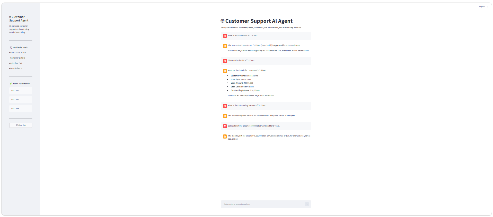

# 🤖 Customer Support AI Agent

An AI-powered customer support assistant built using **Python, LangChain, Gemini 3.6 Flash, Tool Calling, and Streamlit**.

The application allows users to ask customer and loan-related questions. Gemini understands the user's request and automatically selects the appropriate tool to retrieve information or perform calculations.

---

## 🚀 Features

- 🤖 Gemini 3.6 Flash powered AI assistant
- 🔧 LLM Tool Calling
- 🏦 Loan status lookup
- 👤 Customer details lookup
- 💰 Loan balance lookup
- 🧮 EMI calculation
- 💬 Interactive Streamlit chat interface
- 🗑️ Clear chat functionality
- 🧪 Mock banking/customer data
- 🔐 API key stored securely using environment variables

---

## 🛠️ Technologies Used

- Python
- LangChain
- LangChain Core
- Gemini 3.6 Flash
- Tool Calling
- Streamlit
- Python-dotenv

---

## 🧠 How It Works

```text
User Question
      ↓
Streamlit Chat Interface
      ↓
Gemini 3.6 Flash
      ↓
Does the question require a tool?
      ↓
   Yes ───────────── No
    ↓                ↓
Select Tool       Direct Answer
    ↓
Execute Tool
    ↓
Tool Result
    ↓
Gemini
    ↓
Customer-Friendly Response


## 📸 Screenshot

